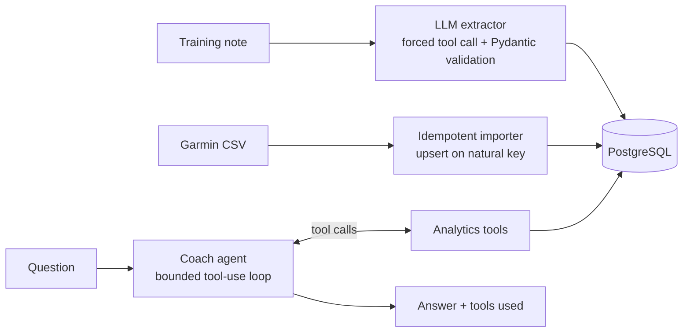

# RunCoach: an AI running coach built on LLM tool use

[](https://github.com/pooyamusavi/runcoach/actions/workflows/ci.yml)

RunCoach turns a runner's **free-text training notes** and **Garmin Connect exports** into
structured, queryable training data, and answers questions about that training with a
**Claude-powered agent that calls analytics tools** over the athlete's real data.

## What it does

| Capability | How |
| --- | --- |
| **Unstructured → structured** | Claude is forced to call a `record_workout` tool whose input schema is a Pydantic model. Output is validated; invalid data (e.g. a heart rate of 400) is rejected, never stored. |
| **Coaching agent** | A bounded tool-use loop. The agent can query weekly mileage, long-run trends, recent activities and notes. Every answer reports which tools it used. |
| **Garmin import** | Parses `Activities.csv`, handles missing values (`--`), and **upserts on a natural key**, so re-importing overlapping exports is idempotent. |
| **Evals** | A labelled set of notes scored field by field (numeric tolerance, exact enums, fuzzy symptom recall), with a regex baseline so LLM gains are measured, not assumed. |
| **Service** | FastAPI + SQLAlchemy, PostgreSQL via Docker Compose (SQLite for local dev), typed with mypy `--strict`, tested with pytest. |



## Quick start

```bash
pip install -e ".[dev]"
cp .env.example .env          # add your ANTHROPIC_API_KEY to use Claude

runcoach import sample_data/garmin_activities_sample.csv
runcoach extract "Long run 28 km at 5:40/km, HR 146, calf tightness after km 24"
runcoach ask "Is my long run getting easier? Any warning signs?"
```

Without an API key, RunCoach falls back to the offline rule-based extractor, and the agent
endpoint is disabled.

### Run the API with PostgreSQL

```bash
docker compose up --build
# http://localhost:8000/docs
```

| Endpoint | Purpose |
| --- | --- |
| `POST /notes` | Extract and store a training note |
| `POST /import/garmin` | Upload a Garmin `Activities.csv` |
| `GET /analytics/weekly` | Weekly distance, runs and hours |
| `GET /analytics/long-runs` | Longest run per week with pace and heart rate |
| `GET /analytics/training-load` | Acute:chronic workload ratio (last 7 days vs. 28-day average); warns above 1.3 |
| `POST /ask` | Ask the coaching agent |

## Evaluation

```bash
python evals/run_evals.py           # rule baseline, offline
python evals/run_evals.py --llm     # Claude extractor
```

| Extractor | Overall field accuracy |
| --- | --- |
| Regex baseline | 79.2% |
| Claude (`record_workout` tool) | *run `--llm` and record your result here* |

The baseline misses paraphrases ("legs felt heavy", "12 clicks", "two and a half hours");
those cases are exactly where the LLM should earn its place.

## Design decisions

- **Forced tool calls + schema validation** instead of free-text JSON parsing: the model can
  only answer in the shape the database accepts.
- **Bounded agent loop** (`RUNCOACH_MAX_AGENT_STEPS`); tool errors and unknown tools are
  returned to the model as errors rather than crashing the request.
- **Deterministic tests**: `ScriptedLLM` replays recorded responses, so the agent and API
  are tested end to end without network calls.
- **Idempotent ingestion**: upserts on `(start_time, activity_type)`.
- **Privacy**: personal training exports are git-ignored. The sample data is synthetic.

## Roadmap

- Eval set expansion and LLM-as-judge scoring for agent answers
- Simple web UI

## Disclaimer

RunCoach offers training insights, not medical advice. See a professional for injuries.

## License

MIT
